<h1 align="center">Hi 👋, I'm Dương Minh Đức</h1>
<h3 align="center">A passionate developer from Viet Nam</h3>

  

- 🔭 Software Engineering Student from **Vietnam**.
- 💻 I'm currently working primarily with **Reactive Programming (Rx.NET)**, **Functional Programming (FP)**, and **Clean Architecture**.
- 👨‍💻 All of my projects are available at **https://github.com/d3nhatv0lam**

---

### Tech Stack

  
    
  
   
   
   
   
  

---

### GitHub Statistics

  
  

<!-- 
 -->

---

### Featured Projects

| Project                                                           | Description                                                                                                                                    | Tech Stack                                           |
| :---------------------------------------------------------------- | :--------------------------------------------------------------------------------------------------------------------------------------------- | :--------------------------------------------------- |
| [**CTU Scheduler**](https://github.com/d3nhatv0lam/CTU-Scheduler) | A cross-platform timetable planner and course scheduling application for Can Tho University students.                                          | `C#` `.NET` `Avalonia` `Rx.NET` `Clean Architecture` |
| [**Chasing Light**](https://github.com/d3nhatv0lam/Chasing-Light) | A 2D puzzle game with a time-loop mechanism. It integrates ASP.NET and Subbase for logging, saving game progress, and displaying leaderboards. | `C#` `Unity` `ASP.NET` `Subabase`                    |

> 📌 Explore more of my open-source projects at **[github.com/d3nhatv0lam](https://github.com/d3nhatv0lam?tab=repositories)**
